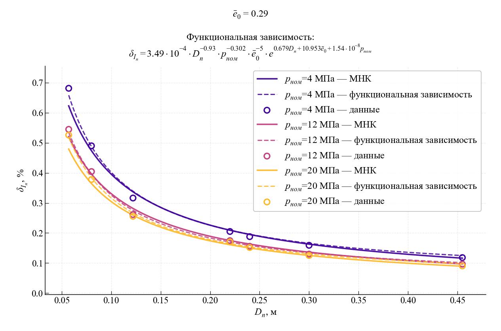
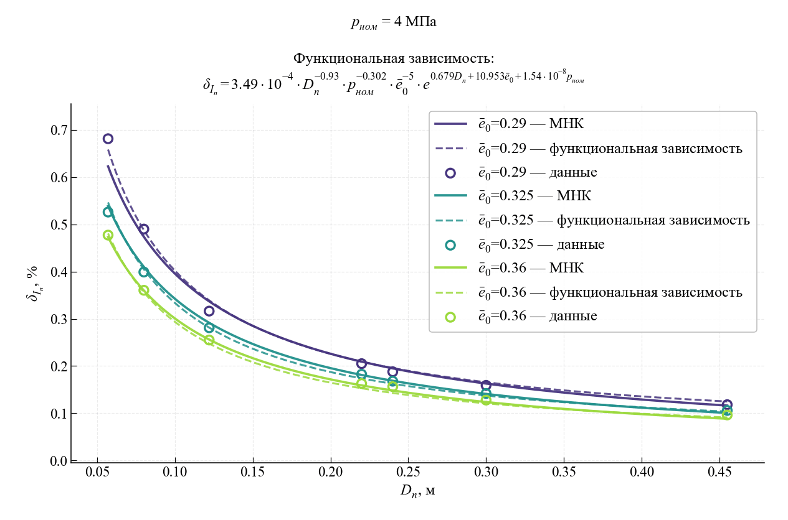
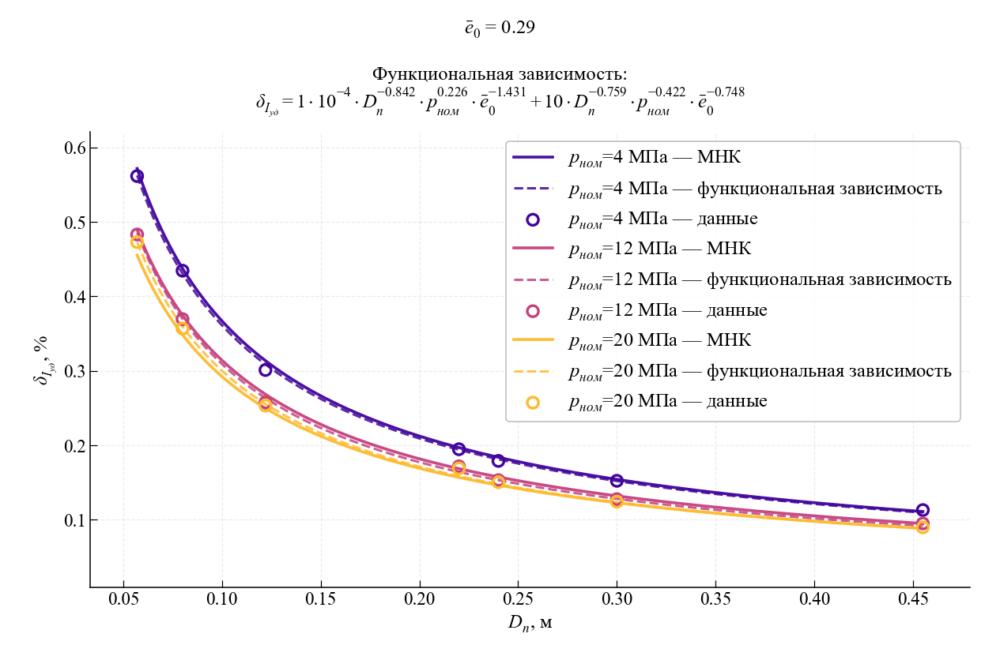
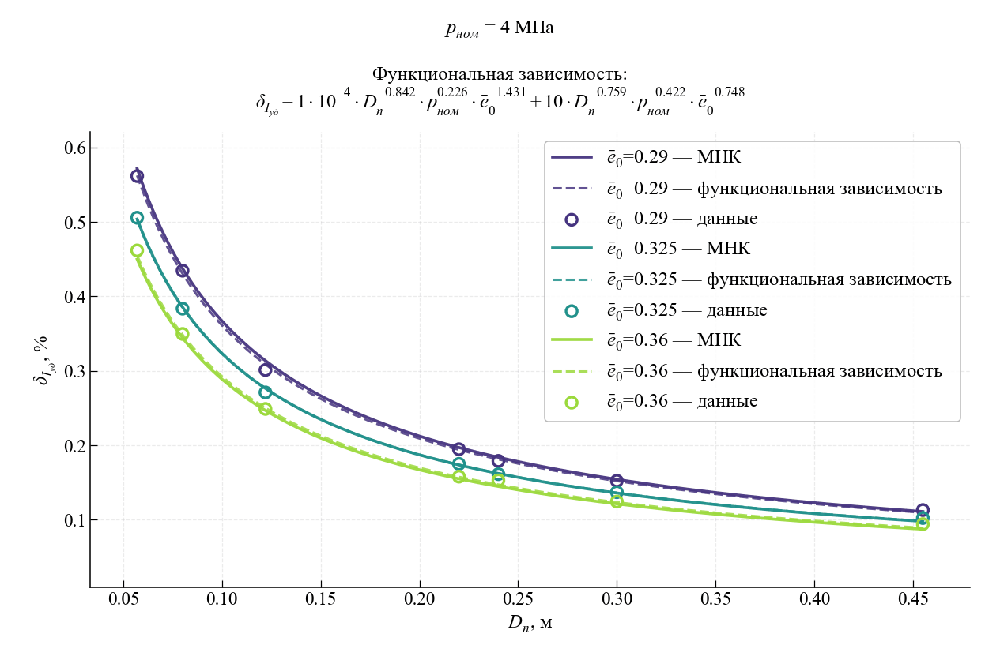
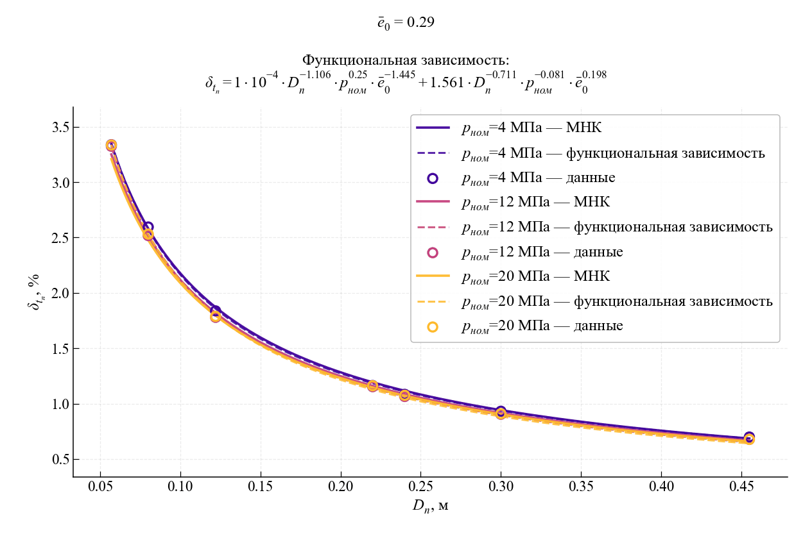
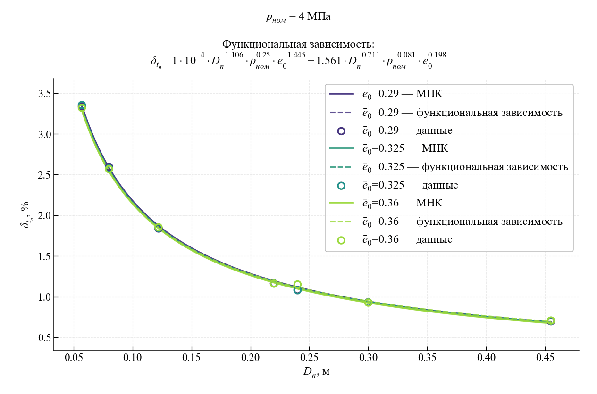

markdown

# 🚀 Оценка влияния допусков формы заряда твердого ракетного топлива и сопла на внутрибаллистические характеристики РДТТ

В данной работе (ЛР3) исследуется влияние **допусков формы заряда твердого ракетного топлива (ТРТ) и сопла** на внутрибаллистические характеристики ракетного двигателя твердого топлива (РДТТ): полный и удельный импульс, полное время горения, максимальное давление. Рассматривается ряд ракетных систем (НАР С-5, С-8, С-13, С-24, «Ураган» 9М27Ф, «Смерч» 9М55, Х-15). Разброс геометрии моделируется методом Монте-Карло по допускам ГОСТ 25346-2013 и ГОСТ 26645-85.

## 📐 Математическая модель

### 1. Исходные данные и допущения

- **Калибры двигателей:** $D_н = 0{,}057 \dots 0{,}455$ м.
- **Диаметр камеры сгорания:** $D_{кс} = 0{,}96\,D_н$.
- **Заряд:** звездообразное сечение, $n = 7$ лучей, $\bar r = 0{,}1$, $\bar e_0 = 0{,}27 \dots 0{,}36$.
- **Топливо:** 13% ПБГГ + 87% ПХА, $\rho_м = 1700$ кг/м³, $u_1 = 4{,}85$ мм/с, $\nu = 0{,}4$, $D_1 = 0{,}002$ K⁻¹.
- **Воспламенитель:** MTV (58% Mg, 38% C₂F₄, 4% Viton), $\rho_в = 1850$ кг/м³, $u = 16{,}9\,(p/10^6)^{0{,}22}$ мм/с.
- **Допуски:** сопло — ГОСТ 25346-2013 (IT8); ТРТ — ГОСТ 26645-85 (квалитет 8).
- **Условие отсутствия эрозионного горения:** параметр Победоносцева $\kappa_0^{доп} = 85$.

### 2. Геометрия заряда ТРТ и сопла

- Полуугол выступа $\beta$: $\frac{\pi}{2} + \frac{\pi}{n} - \beta \cdot \mathrm{ctg}\,\beta = 0$.
- Минимальная толщина свода: $e_0 = \frac{\bar e_0 D_{кс}}{2}$.
- Радиус скругления: $r = \bar r R$, где $R = \frac{D_{кс}}{2}\cdot\frac{1-\bar e_0}{1+\bar r}$.
- Периметр канала $\Pi(e)$ и площадь горения $S_2(e) = \Pi(e)\cdot l_{зар}$ — по трём стадиям горения (плоские выступы → цилиндрические скругления → дегрессивные остатки).
- Длина заряда из условия $\kappa_0=85$: $l_{зар} = \kappa_0 F_{кр}\frac{1-\varepsilon_f}{\Pi_0}$.
- Масса топлива: $\omega_т = l_{зар}\,\rho_м\,\varepsilon_f F_{кр}$.

### 3. Воспламенительный состав

- Таблетка двояковыпуклой формы; масса $\omega_в$ и толщина свода $e_в$ оптимизируются.
- Критерий: $\min C$ — минимум отношения $p_{\max}/p_{ном}$ и времени воспламенения $t_{ign}$, решение на фронте Парето.

### 4. Прямая задача внутренней баллистики

Решается система ОДУ для $p(t)$, $T(t)$, $W(t)$, $c_p(t)$, $R(t)$, $e_в(t)$, $e(t)$, $\eta_T(t)$:

$$
\frac{dp}{dt} = \frac{k-1}{W}\left(X + \frac{k}{k-1}Y\right),\quad
\frac{dT}{dt} = \frac{k-1}{\rho W R}(X+Y),
$$

$$
\frac{dW}{dt} = \frac{G_в}{\rho_в} + \frac{G_т}{\rho_т},\quad
\frac{de_в}{dt} = u_в \Phi_0,\quad
\frac{de}{dt} = u\,\varphi_\kappa\,\Phi_1.
$$

Учитываются **эрозионное горение** ($\varphi_\kappa$), **теплообмен** от воспламенителя ($q_{зар}$), **изменение площади поверхности горения** $S(e)$. Интегрирование — **метод Рунге-Кутты 4-го порядка**.

### 5. Допуски и метод Монте-Карло

- Назначение допусков на $e_0$, $D_{кс}$, $r$, $l_{зар}$, $D_{кр}$, $D_а$ по ГОСТ.
- Разброс **10 000** реализаций геометрии по нормальному закону.
- Проверка устойчивости метода: достаточно **N = 750** комбинаций для заданной точности.
- Для каждой модели — мат. ожидание $\mu$, СКО $\sigma$, дисперсия $\sigma^2$, процент разброса:

$$
\delta = \left(\frac{\mu \pm 3\sigma}{\mu} - 1\right)\cdot 100\%.
$$

---

## 📊 Ключевые результаты

На основе регрессионного анализа результатов Монте-Карло получены зависимости разброса выходных характеристик (R² > 0,99).

### 🔹 Разброс полного импульса $\delta_{I_p}$, %

$$
\delta_{I_p} = 3{,}49\cdot10^{-4}\cdot D_{\text{н}}^{0{,}93}\cdot p_{\text{ном}}^{0{,}302}\cdot \bar e_0^{-5}\cdot e^{\,0{,}679\,D_{\text{н}} + 10{,}953\,\bar e_0 + 1{,}54\cdot10^{-8}\,p_{\max}}
$$

### 🔹 Разброс удельного импульса $\delta_{I_{уд}}$, %

$$
\delta_{I_{уд}} = 10^{-4}\cdot D_{\text{н}}^{0{,}842}\cdot p_{\text{ном}}^{0{,}226}\cdot \bar e_0^{-1{,}431} + 10\cdot D_{\text{н}}^{0{,}759}\cdot p_{\text{ном}}^{0{,}442}\cdot \bar e_0^{-0{,}748}
$$

### 🔹 Разброс полного времени горения $\delta_{t_п}$, %

$$
\delta_{t_п} = 10^{-4}\cdot D_{\text{н}}^{1{,}106}\cdot p_{\text{ном}}^{0{,}25}\cdot \bar e_0^{-1{,}445} + 1{,}561\cdot D_{\text{н}}^{0{,}711}\cdot p_{\text{ном}}^{-0{,}081}\cdot \bar e_0^{0{,}198}
$$

| Обозначение | Наименование | Единица измерения |
|:---:|:---|:---:|
| $\delta_{I_p}$ | Разброс полного импульса | % |
| $\delta_{I_{уд}}$ | Разброс удельного импульса | % |
| $\delta_{t_п}$ | Разброс полного времени горения | % |
| $D_н$ | Калибр двигателя | м |
| $p_{ном}$ | Номинальное давление в камере сгорания | МПа |
| $\bar e_0$ | Безразмерная толщина свода заряда | — |

### 📈 Качество аппроксимации

| Зависимость | R² | CAO | СКО |
|:---:|:---:|:---:|:---:|
| $\delta_{I_p}$ | 0,99703 | 0,00597 | 0,00773 |
| $\delta_{I_{уд}}$ | 0,99887 | 0,00313 | 0,00433 |
| $\delta_{t_п}$ | 0,99952 | 0,01643 | 0,01940 |

### 🖼 Графики зависимостей

